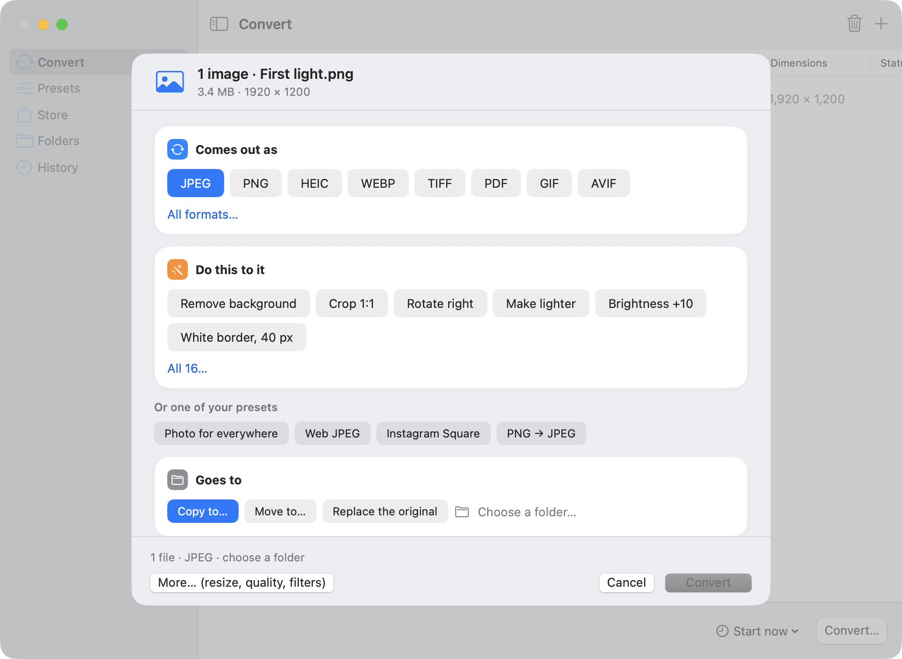
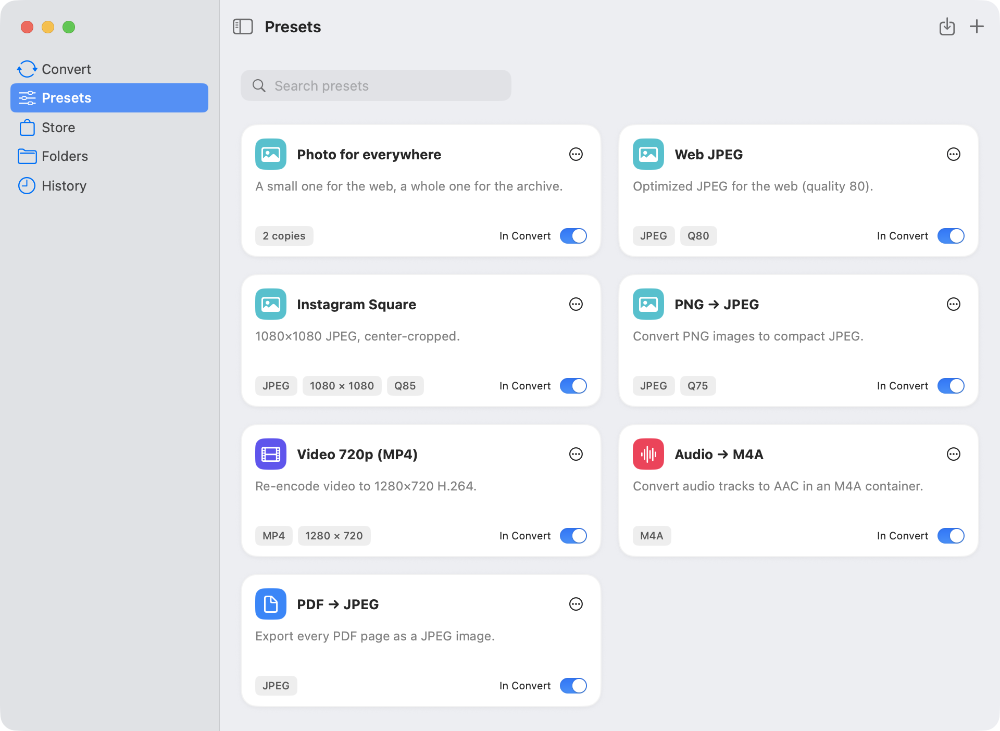
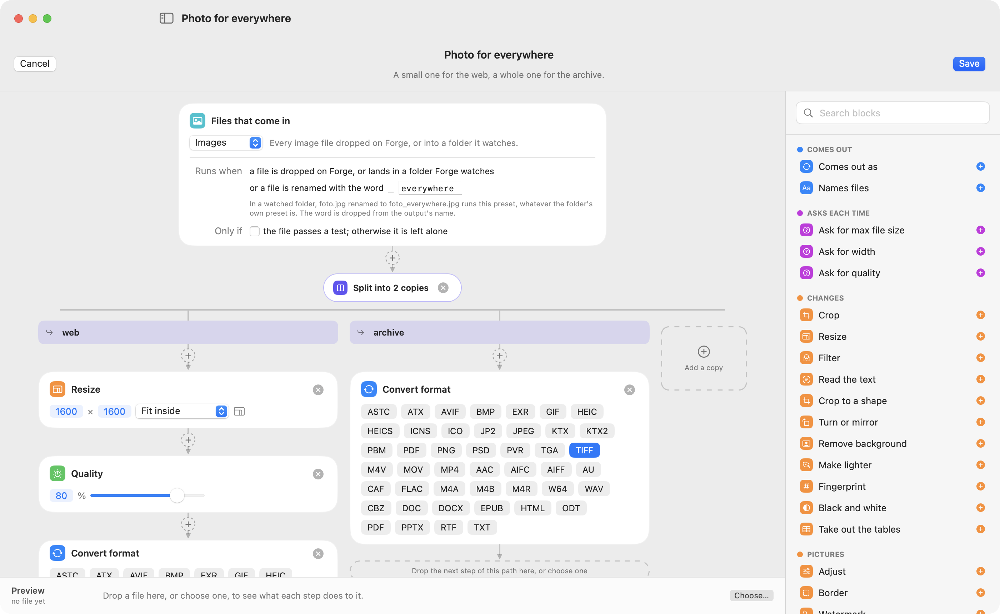
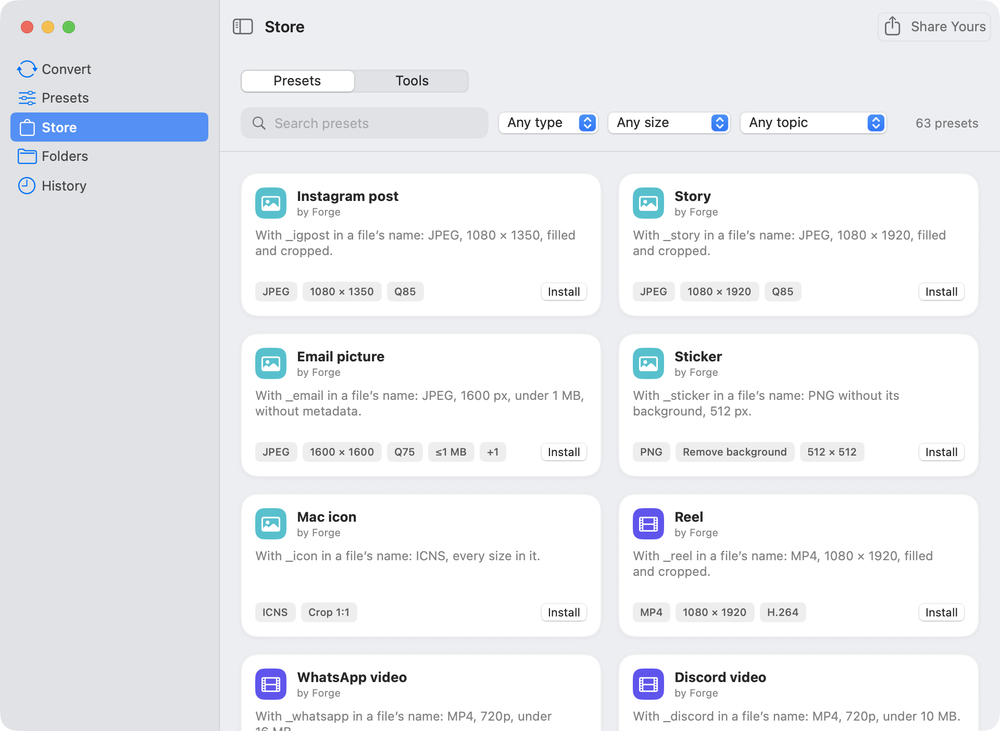
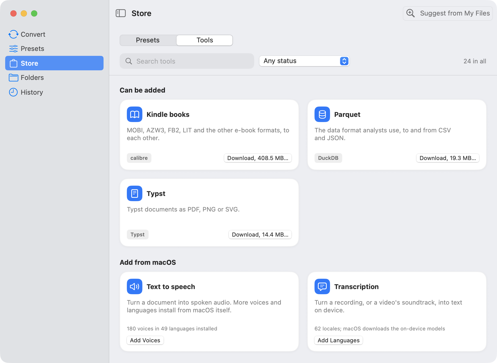
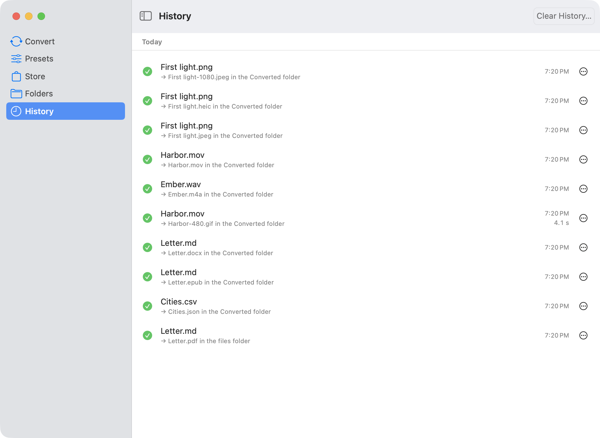

<div align="center">


# Forge

**Rename a file, and it becomes what you called it.**<br>
A free, open source file converter for macOS.

[Download](https://github.com/thousandflowers/Forge/releases/latest) · [What it does](#what-it-does-to-a-file) · [Command line](#command-line) · [Build it](#build-it-yourself)

[](https://github.com/thousandflowers/Forge/actions/workflows/build.yml)
[](https://developer.apple.com/macos)
[](LICENSE)

</div>

Photos, videos, recordings, documents, spreadsheets, 3D models, subtitles, fonts. Forge converts them on your Mac, with the frameworks macOS already has. Your files never leave it.

> Alpha. It works, it is tested, and it is still changing week to week.

## Say it in the name

Choose a folder to watch, and rename a file in it:

| You rename it | You get |
| --- | --- |
| `Letter.md` → `Letter.pdf` | A PDF |
| `clip.mov` → `clip.gif` | An animated GIF |
| `holiday.jpg` → `holiday_2MB.jpg` | The same photo, under 2 MB |
| `holiday.jpg` → `holiday_800px_privacy.jpg` | 800 pixels wide, without the place it was taken |
| `sheet.jpg` → `sheet_scan.jpg` | The sheet in the photo, straightened and lit |
| `talk.m4a` → `talk.txt` | What is said in it |
| `anything_ask.jpg` | A small menu beside the pointer asks what you want |

Turn on **Only when renamed** and every other file in the folder is left alone, so a whole Desktop can be watched. Your own presets can have a word too: give one the word `web`, and `photo_web.jpg` runs it.

## Or any other way you like

- **Drop it** on the window, on the Dock icon or on the menu bar.
- **Drag it with a key held down**, and a menu opens over the file with what it can become. It comes out of the notch too, on a Mac that has one.
- **Right-click it** in the Finder, under Services.
- **Let a folder do it.** Whatever lands in a watched folder is converted as it arrives.
- **Call it** from Shortcuts, from the command line, or from an assistant.

Dragging, the notch and the conversions nobody asks for are off until you turn them on in Settings.

## The window

<picture>
  <source media="(prefers-color-scheme: dark)" srcset="docs/screens/convert-dark.png">
  
</picture>

Drop some files, and Forge asks what they should become: a photo is asked about its size and quality, a video about its codec, a recording about its words. A file is offered only what it can become on this Mac, and a control that would be ignored is not shown. Files of different kinds go through a preset together.

**A size is a promise, not a setting.** Ask for 2 MB and Forge writes the file, measures it, and writes it again until it fits, giving up quality first and pixels only after that. If it cannot get there, it says so.

## What it does to a file

Forty-five things, each one a block in a preset, a word in a name, and `--do` on the command line.

| | |
| --- | --- |
| **Pictures** | `_nobg` `_scan` `_enhance` `_upscale2x` `_crop1x1` `_blurbg` `_gray` `_round40` `_border40` `_mark(©)` `_grid3x3` `_layers` |
| **Videos** | `_trim10-45` `_crop16x9` `_speed2x` `_slowmo2x` `_mute` `_reverse` `_loop3` `_1080p` `_fps30` `_frames5s` `_at12s` `_splitchapters` |
| **Sound** | `_voice` `_normalize` `_nosilence` `_fade3s` `_pitch+2` `_mono` `_wave` |
| **PDF** | `_lighter` `_pages2-5` `_nopages1` `_splitpages` `_2up` `_numbers` `_tables` `_images` `_dpi300` `_askpassword` `_unlock` |
| **The rest** | `_min` and `_pretty` for JSON, XML, CSS and JavaScript, `_sha256` and `_base64` for anything |

Words add up: `clip_trim10-45_mute_720p.mp4` does all three. Some need a tool that macOS does not come with, and Forge says which one.

## Presets

<picture>
  <source media="(prefers-color-scheme: dark)" srcset="docs/screens/presets-dark.png">
  
</picture>

A preset is a chain of blocks, drawn the way Shortcuts draws one. It can ask a question each time it runs, write several formats at once, take different ways for different files with **If**, and split into copies that are joined again later, or merged into one PDF.

<picture>
  <source media="(prefers-color-scheme: dark)" srcset="docs/screens/editor-dark.png">
  
</picture>

A preset is data, not code: a name and a list of things Forge already knows how to do. Installing somebody else's cannot make the app do anything new.

## The Store

<picture>
  <source media="(prefers-color-scheme: dark)" srcset="docs/screens/store-dark.png">
  
</picture>

Ready-made presets, one for each thing Forge does, and the presets other people have published.

**Tools** lists what your Mac can do, read from your Mac at that moment, and what is missing. Nothing else has to be installed for the core to work. For the rest (ffmpeg, pandoc, WebP, LibreOffice, calibre, DuckDB, Blender, Typst), press Download: Forge fetches the build it was tried with from whoever makes it, checks its fingerprint before using it, and keeps it in its own folder. No Homebrew, no password. Nothing is fetched until you press.

<picture>
  <source media="(prefers-color-scheme: dark)" srcset="docs/screens/tools-dark.png">
  
</picture>

## Careful with your files

- A conversion is written to one side and moved into place when it is whole.
- Two files heading for the same name both arrive.
- Replacing originals asks first, and keeps a backup unless you turn that off.
- A file that would come out heavier is not handed over as a lighter one.
- Every conversion is in **History**, where it can be undone, run again or saved as a preset.

<picture>
  <source media="(prefers-color-scheme: dark)" srcset="docs/screens/history-dark.png">
  
</picture>

## What leaves with your files

A photograph carries where it was taken, and a PDF carries who wrote it. Forge can keep everything, remove the place, or remove whatever identifies a person, a device or a moment: in Settings, in a preset, for one batch, or with `_privacy` in a name. The color profile and the orientation always stay, because without them the picture comes out wrong.

Forge can also suggest faces and names to cover up. It misses things, so every box starts unticked and nothing is covered until you say so. It is help, not anonymization.

## Install

Take the `.dmg` from [Releases](https://github.com/thousandflowers/Forge/releases/latest), open it, and drag Forge to Applications. It runs on Apple silicon and Intel, on macOS 13 Ventura or later.

It is not notarized, so macOS stops the first launch:

- **macOS 15 or later:** open Forge once, close the warning, then go to System Settings, Privacy & Security, and press **Open Anyway**.
- **macOS 13 and 14:** right-click the app and choose **Open**.

## Command line

The app is also `forge`:

```bash
ln -s /Applications/Forge.app/Contents/MacOS/Forge /usr/local/bin/forge
```

```bash
forge convert *.png --to jpeg --quality 80 --out ./web
forge convert clip.mov --do trim10-45 --do mute --out ./out
forge convert photo.heic --preset "Web JPEG" --out ~/Desktop
forge join one.pdf two.pdf --out ./out
forge watch ~/Desktop --preset "Web JPEG" --out ~/Desktop --only-renamed
forge formats
```

It uses the presets you made in the app, writes to the same History, and exits non-zero if a file failed. Converted paths go to stdout, problems to stderr.

`forge mcp` lets an assistant convert, over the Model Context Protocol. It works on copies: an original is never replaced from there.

## Build it yourself

```bash
git clone https://github.com/thousandflowers/Forge.git
cd Forge
./Scripts/build_app.sh      # makes build/Forge.app
open build/Forge.app
```

`swift build` alone makes an executable without a bundle, and macOS shows no window for it. `swift test` runs everything, in a folder of its own, and never touches your data.

<details>
<summary>How it fits together</summary>

```
SwiftUI  ──▶  ProcessingCoordinator  ──▶  one processor for each kind of file
                     │                     (Core Image, AVFoundation, PDFKit, Vision, ModelIO)
              names and places             MonitoredFolderWatcher (FSEvents)
              write aside, then move       PersistenceManager (JSON in Application Support)
```

- **FormatCatalog** asks the Mac what it can read and write.
- **ConvertKind** decides what a file is worth being asked.
- **ProcessingCoordinator** picks the processor, runs the chain, and names the result.
- **Toolbox** fetches a tool when you ask for it.

</details>

## Not here yet

- Notarization.
- Translating subtitles. Doing it offline needs more than macOS 13 has, and Forge will not send your files to a server to do it.

[The roadmap](docs/ROADMAP.md) has the longer list, with what Forge will not do and why.

## Contributing

Fork, branch, keep `swift test` green, open a pull request.

MIT. See [LICENSE](LICENSE).
